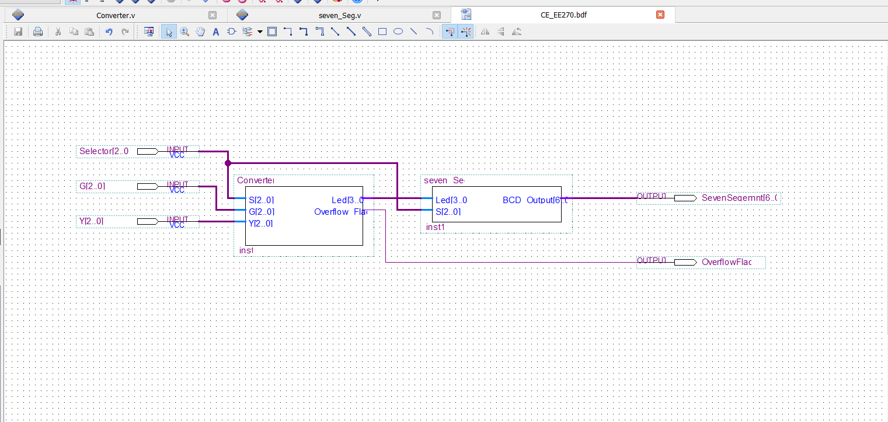
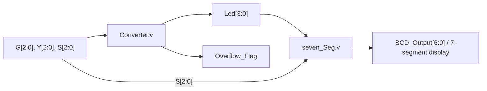
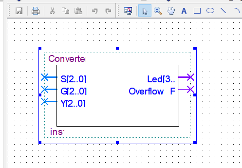
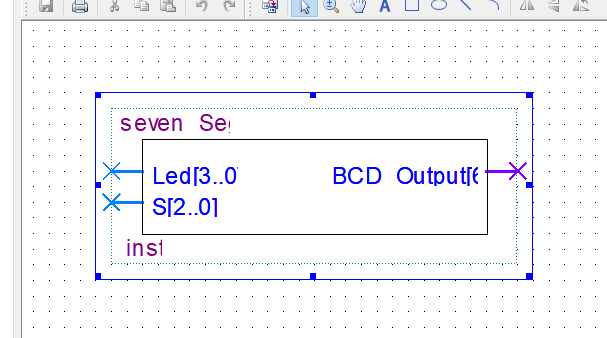
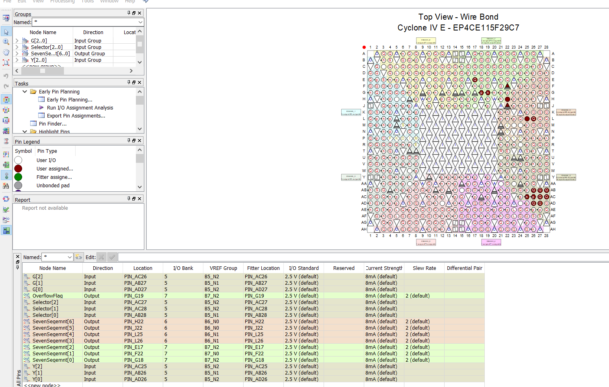
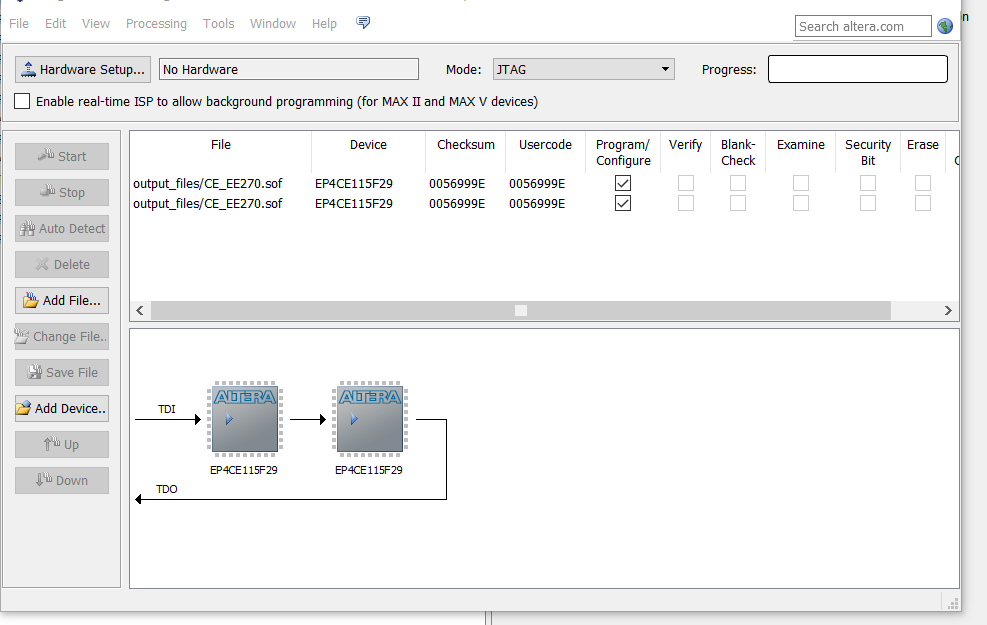

# FPGA Digital Temperature Converter

**Multi-function 3-bit digital arithmetic and logic unit with seven-segment output, designed in Verilog for an Intel/Altera Cyclone IV E FPGA.**

**Author:** [Waleed Alakwa](https://github.com/WaleedAlakwa)  
**Language:** Verilog HDL  
**Development environment:** Intel/Altera Quartus (version not specified in the supplied materials)  
**Device shown in the project screenshots:** Cyclone IV E **EP4CE115F29C7**  
**License:** [MIT](LICENSE) (for the original source and documentation to which the repository owner holds the rights)

> **Project status:** The original `Converter.v` and `seven_Seg.v` modules and the supplied Quartus screenshots are included. A supplementary HDL top-level and example testbench are provided for easier exploration; they are newly prepared for this repository and are not the original Quartus block-diagram file. The Quartus project (`.qpf`, `.qsf`, `.bdf`) and waveform source files were not supplied. Compilation, hardware programming, and simulator execution have **not** been independently reproduced as part of preparing this repository.

## Overview

The system selects one of eight operations using a three-bit selector (`S[2:0]`). The `Converter` module processes two unsigned three-bit operands (`G` and `Y`), produces a four-bit value (`Led`), and asserts `Overflow_Flag` for selected out-of-range operations. The `seven_Seg` module converts `Led` into a seven-bit **active-low** display pattern (`BCD_Output`).

The supplied Quartus diagrams show these modules joined into a schematic top level with switch inputs and outputs connected to a seven-segment display and overflow indicator.



## Features

- Eight selectable operation modes, `000` through `111`.
- Three-bit operands and four-bit intermediate result.
- Equality / non-equality indication (`E` / `U`) using the seven-segment output.
- Arithmetic (`G + 4`, `7 - Y`) and bitwise logic operations.
- Overflow indication and display-disable mode.
- Quartus pin-assignment and captured simulation-waveform references.

### Operation selector

The table below describes the **behavior of the uploaded Verilog**, including its current limitations; it is not a claim that all envisioned operations are fully implemented.

| `S` | Function in original source | `Led` / display behavior | Overflow behavior |
|---|---|---|---|
| `000` | `G` to Fahrenheit (placeholder) | `0` | Always `1`; no numeric Fahrenheit conversion |
| `001` | `Y` to Fahrenheit (placeholder) | `0` | Always `1`; no numeric Fahrenheit conversion |
| `010` | Compare `G` and `Y` | `E` if equal (`Led = 6`); `U` otherwise (`Led = 9`) | Set to `0` for *unequal* values; **not assigned** for equal values |
| `011` | `G + 4` | Sum `4`–`9`, or `0` when result > `9` | `1` for `G` = `6` or `7` |
| `100` | `7 - Y` (3-bit bitwise complement) | `0`–`7` | `0` |
| `101` | `G AND 3'b111` | `G` (`0`–`7`) | `0` |
| `110` | `~(G AND 3'b000)` | `7` | `0` |
| `111` | System disabled | Blank display (`Led = 15`) | `0` |

**Important:** `Overflow_Flag` is not assigned in the `S=010, G=Y` branch of `Converter.v`. This produces incomplete combinational assignment (latch-like behavior). See [Known limitations](docs/KNOWN_LIMITATIONS.md) before using this code in hardware.

## Architecture



The provided `rtl/temperature_converter_top.v` connects these original modules in HDL. This supplementary top-level was **reconstructed from the visible block-diagram connections** and is not a replacement for the missing original `.bdf` file.

## Repository contents

```text
FPGA-Digital-Temperature-Converter/
├── README.md
├── LICENSE
├── CITATION.cff
├── .gitignore
├── THIRD_PARTY_NOTICES.md
├── rtl/
│   ├── Converter.v                      # Original file, unchanged
│   ├── seven_Seg.v                      # Original file, unchanged
│   └── temperature_converter_top.v       # Supplementary HDL wrapper
├── sim/
│   └── tb_temperature_converter.v        # Supplementary smoke-test bench
├── quartus/
│   └── pin_assignments_example.qsf       # Example assignments, not full project
├── docs/
│   ├── OPERATIONS.md
│   ├── PIN_ASSIGNMENTS.md
│   ├── QUARTUS_SETUP.md
│   ├── SIMULATION.md
│   └── KNOWN_LIMITATIONS.md
└── assets/
    └── screenshots/                     # Original supplied design/screenshots
```

## Getting started

### View or rebuild in Quartus

1. Install a Quartus edition/version supporting Cyclone IV E (`EP4CE115F29C7`).
2. Create a new Quartus project and select the matching target device; confirm your actual FPGA package/board.
3. Add `rtl/Converter.v`, `rtl/seven_Seg.v`, and `rtl/temperature_converter_top.v`.
4. Use `temperature_converter_top` as the top-level entity (or reconstruct the schematic from the screenshots).
5. Review the [pin assignments](docs/PIN_ASSIGNMENTS.md) and example `.qsf` before applying any constraints to actual hardware.
6. Compile and review the messages, warnings and reports. The original project's vendor files and `.sof` bitstream are **not** included.

See [Quartus setup](docs/QUARTUS_SETUP.md).

### Simulate with Icarus Verilog (optional)

If you have [Icarus Verilog](https://steveicarus.github.io/iverilog/) installed:

```bash
iverilog -g2012 -o sim/tb_converter.out \
  rtl/Converter.v rtl/seven_Seg.v rtl/temperature_converter_top.v \
  sim/tb_temperature_converter.v
vvp sim/tb_converter.out
```

This testbench covers representative functional cases and logs the known equality/overflow issue; it **has not been executed in the packaging environment**. It is not a replacement for timing simulation, synthesis checks, or real-hardware testing. See [Simulation](docs/SIMULATION.md).

## Design and simulation evidence

| Design block | Quartus capture |
|---|---|
| Converter symbol |  |
| Seven-segment decoder symbol |  |
| Pin Planner |  |
| JTAG Programmer |  |

The following screenshots show captured waveforms for the eight selector settings. They demonstrate the supplied work visually, but **the underlying waveform (`.vwf`) and complete Quartus project are not in this repository**.


[Composite waveform overview](assets/screenshots/00552.png) · [Additional block diagram with annotated pins](assets/screenshots/bdf1.png)

## Reproducibility and limitations

- Only two original Verilog modules were supplied. The additional top-level, testbench and `.qsf` example were prepared for documentation and reuse, not recovered from the original project.
- `S=000/001` flags a three-bit-input Fahrenheit conversion as overflow; it **does not output a converted °F number**.
- The equality branch leaves `Overflow_Flag` unassigned.
- The supplied Programmer screenshot shows **“No Hardware”**; it demonstrates a programming configuration, **not confirmed hardware programming**.
- Verify seven-segment bit order and active-low behavior against your actual board.
- No independent compilation, simulation execution or device programming is claimed.

See [all known limitations](docs/KNOWN_LIMITATIONS.md).

## Author and citation

**Waleed Alakwa**  
GitHub: [github.com/WaleedAlakwa](https://github.com/WaleedAlakwa)

If you use this repository in academic work, please consider citing it using [CITATION.cff](CITATION.cff).

## License

Distributed under the [MIT License](LICENSE), subject to the original author's ownership and any applicable third-party rights. Copyright © 2026 Waleed Alakwa. The MIT license requires retaining its copyright and permission notice in copies or substantial portions of the software; it does not require prominent credit in every application. See [third-party notices](THIRD_PARTY_NOTICES.md).
